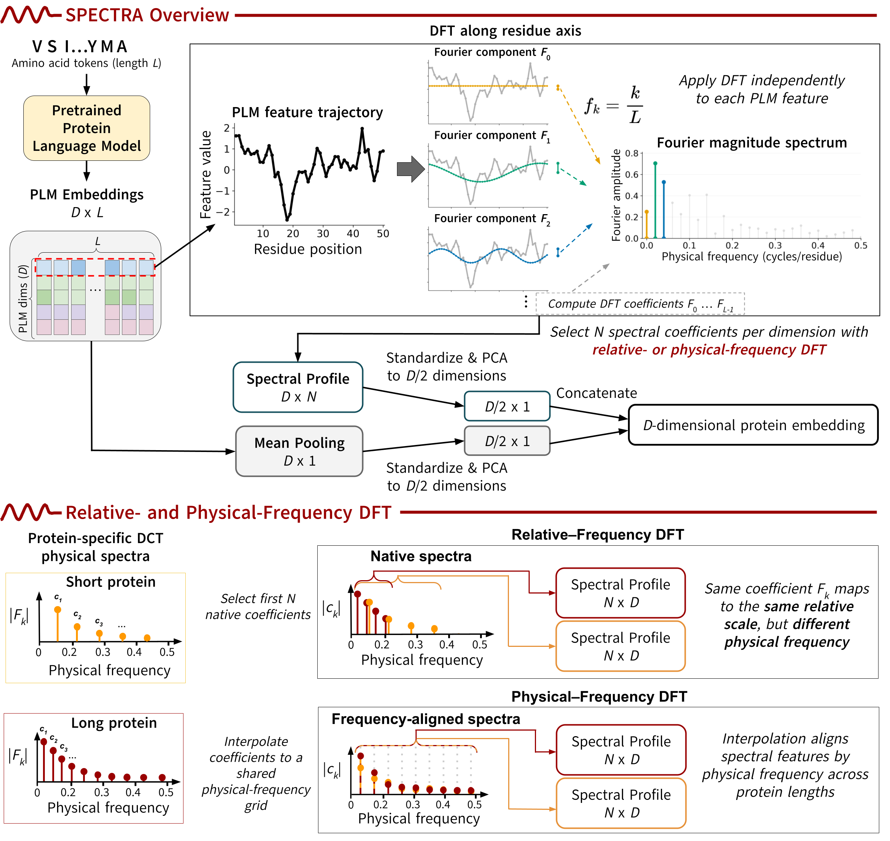

# SPECTRA: Spectral Protein Representations

**SPECTRA** is a framework for generating fixed-dimensional protein representations from protein language model (PLM) embeddings using spectral transformations.

SPECTRA applies the Discrete Cosine Transform (DCT) or Discrete Fourier Transform (DFT) along the protein sequence dimension to capture sequence-level information beyond conventional mean pooling. We investigate both relative-frequency and physical-frequency representations across protein language models and downstream prediction tasks.

## Repository Structure

- `plm_wrapper.py` — Protein language model embedding extraction.
- `homology_experiments.py` — Remote homology detection experiments.
- `regression_experiments.py` — Protein property prediction experiments.
- `utils.py` — Shared utilities.

## Benchmarks

We evaluate SPECTRA on:

- **Remote homology detection:** ASTRAL40/SCOPe.
- **Protein property prediction:** Fluorescence, β-lactamase activity, protein–protein interaction affinity, and solubility.

## Acknowledgments

The protein property prediction experiments build upon the [BoM-Pooling](https://github.com/Singh-Lab/bom-pooling) codebase. We thank the authors for making their implementation publicly available.
