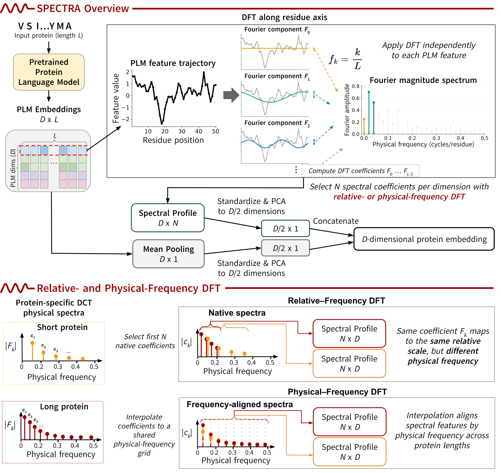

# SPECTRA: Spectral Protein Representations

**SPECTRA** is a framework for generating fixed-dimensional protein representations from protein language model (PLM) embeddings using spectral transformations.

SPECTRA applies the Discrete Fourier Transform (DFT) or Discrete Cosine Transform (DCT) along the protein sequence dimension to capture sequence-level information beyond conventional mean pooling. We investigate relative-frequency and physical-frequency representations across PLMs and downstream prediction tasks.

## Repository Structure

- `config.py` — Shared paths, model configurations, and method definitions.
- `plm_wrapper.py` — PLM embedding extraction.
- `utils.py` — Spectral transformations and shared utilities.
- `load_data.py` — Dataset loading and preprocessing.
- `fit_external.py` — External standardization and PCA fitting.
- `homology_embed.py` — ASTRAL40 residue and CLS embedding extraction.
- `homology_compress.py` — Protein-level representation generation.
- `homology_evaluate.py` — Remote homology detection evaluation.
- `regression_experiments.py` — Protein property prediction experiments.

## Benchmarks

### Remote Homology Detection

We evaluate protein representations on **ASTRAL40/SCOPe** using all-by-all protein similarity comparisons.

The pipeline consists of four stages:

1. **External fitting (`fit_external.py`):** Estimate standardization parameters and fit PCA transformations using 25,000 UniRef50 proteins.
2. **Embedding extraction (`homology_embed.py`):** Extract per-residue PLM embeddings for ASTRAL40 proteins, along with CLS embeddings for ESM models.
3. **Compression (`homology_compress.py`):** Generate fixed-dimensional representations using:
   - Mean pooling, with and without standardization.
   - Relative-frequency DCT and DFT.
   - Physical-frequency DCT and DFT.
   - PROST-like 2D-iDCT as a reference method.

   Spectral methods concatenate PCA-reduced mean-pooled and spectral features, producing representations with the original PLM embedding dimension. CLS pooling is generated separately during embedding extraction.
4. **Evaluation (`homology_evaluate.py`):** Compute pairwise cosine or Euclidean distances between ASTRAL40 representations. Proteins belonging to the same SCOPe superfamily are considered homologous (positives), while proteins from different superfamilies are non-homologous (negatives). We report AUROC with same-family comparisons included or excluded, aggregated overall and at the protein, family, and superfamily levels. AUROC is reported at four levels: overall, per-protein, per-family, and per-superfamily. Family- and superfamily-level AUROCs are computed from pooled distance distributions.

### Protein Property Prediction

We evaluate SPECTRA on two downstream tasks:

- Fluorescence prediction
- Protein–protein interaction affinity prediction

Experiments are implemented in `regression_experiments.py`.

## Acknowledgments

The protein property prediction experiments build upon the [BoM-Pooling](https://github.com/Singh-Lab/bom-pooling) codebase. We thank the authors for making their implementation publicly available.
